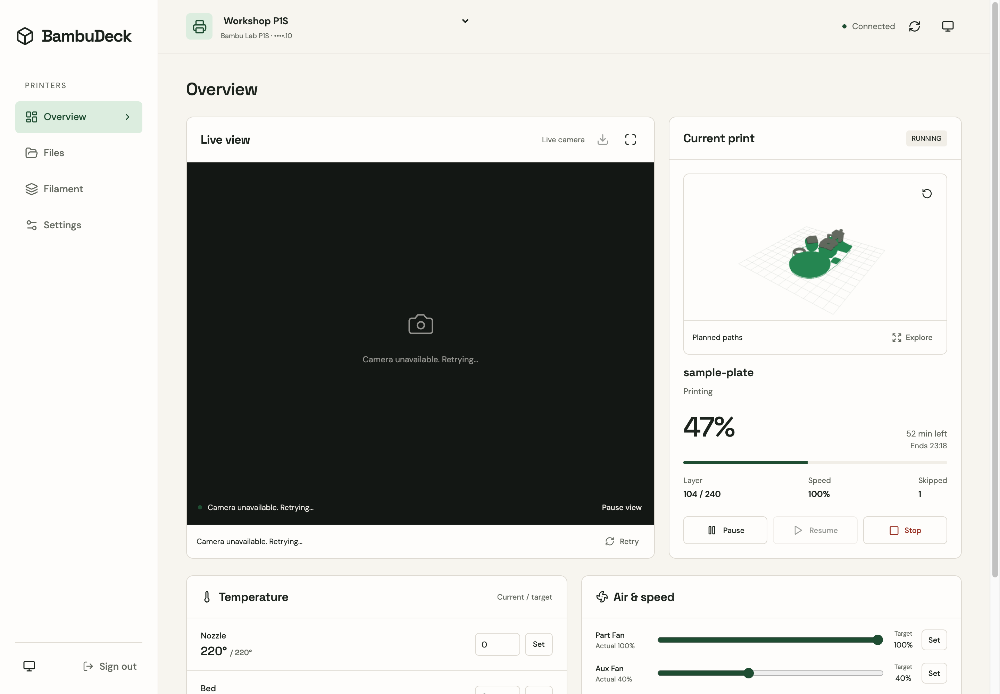
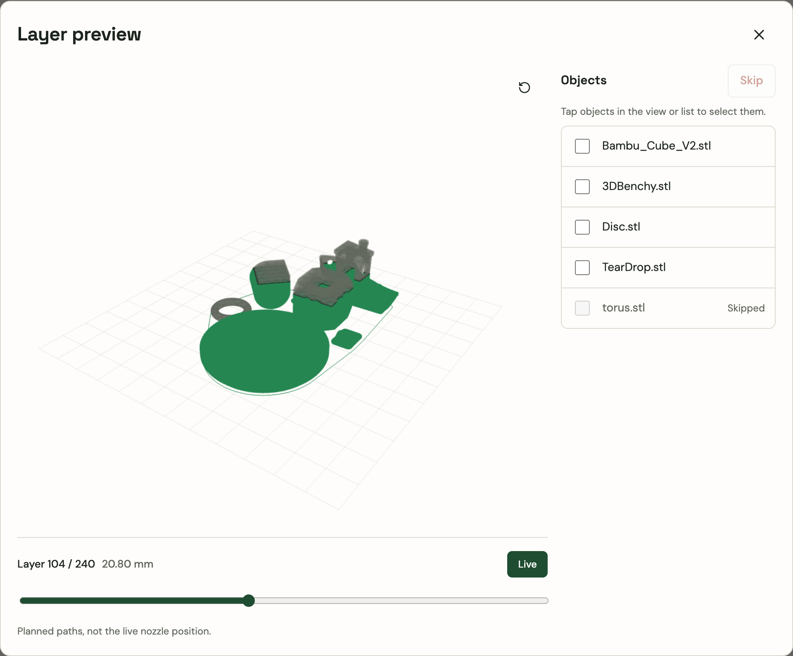
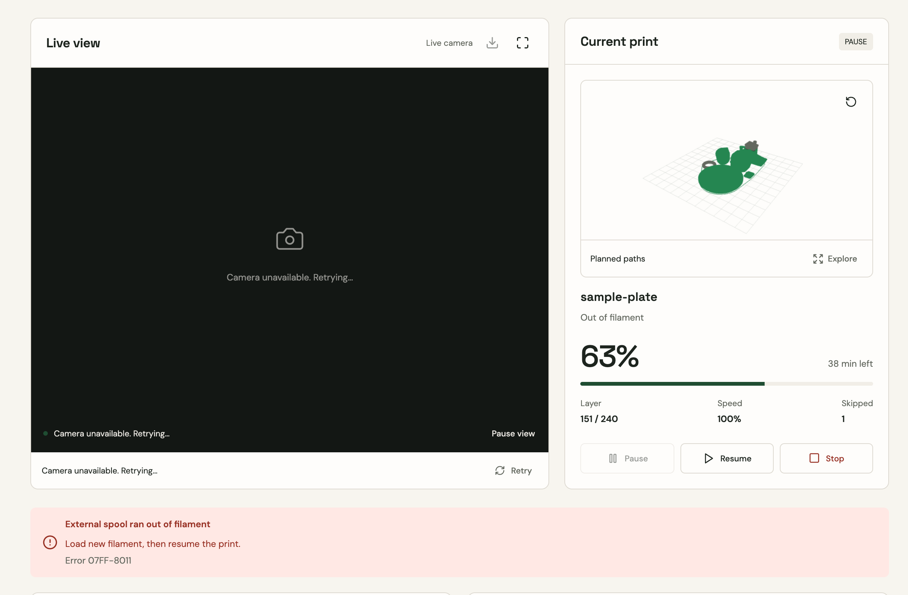
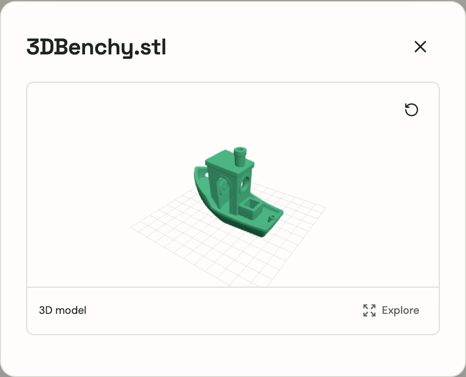
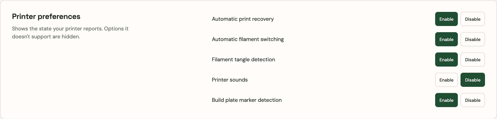
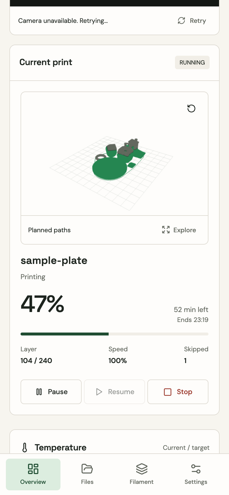

# BambuDeck

A mobile dashboard for Bambu Lab printers in LAN mode. Monitor prints and cameras, manage files and AMS filament, and control printers from a Vue PWA. Bun/Elysia serves the app and stores credentials in encrypted SQLite.

[Documentation](https://ripwords.github.io/BambuDeck/) · [Docker Hub](https://hub.docker.com/r/ripwords/bambudeck)

## Features

- Live print progress, temperatures, fans, AMS trays, and camera snapshots.
- 3D layer preview of the sliced toolpath that follows the reported layer. Scrub any layer instantly.
- Skip individual objects mid-print from the preview.
- Choose which sliced plate of a multi-plate 3MF to print. The preview reloads when the next plate starts.
- Filament runout detection with pause reasons and error codes.
- Printer preferences (auto recovery, filament switching, tangle and plate-marker detection, sounds) highlight the state the printer reports.
- LAN printer discovery, and automatic recovery when a printer's IP address changes.
- File browser for printer storage with search, sorting, upload, ZIP download, and STL/3MF previews.
- Home Assistant entities through MQTT Discovery.
- Password sign-in with Better Auth; printer credentials encrypted in SQLite.

See [feature coverage](docs/FEATURES.md) for model-dependent limits.

## Screenshots

The screenshots use sample telemetry. The previews show real geometry: Bambu Studio's bundled sample models (3DBenchy, cube, disc, torus, teardrop) sliced with its command-line slicer and rendered by BambuDeck's own parser. No camera is connected.



<details>
<summary>Layer explorer and object skipping</summary>



</details>

<details>
<summary>Filament runout</summary>



</details>

<details>
<summary>STL preview from the file browser</summary>



</details>

<details>
<summary>Printer preferences</summary>



</details>

<details>
<summary>Mobile dashboard</summary>



</details>

## Run with Docker

```sh
mkdir bambudeck
cd bambudeck
curl -fsSL https://raw.githubusercontent.com/Ripwords/BambuDeck/main/compose.production.yaml -o compose.production.yaml
docker compose -f compose.production.yaml up -d
```

Open `http://localhost:3000`, or `http://<docker-host-ip>:3000` from your phone. Create a password and add your printer's IP address, LAN access code, and serial number. Enable LAN mode and let the Docker host reach the printer.

Published images support AMD64 and ARM64. If no release is published yet, build locally:

```sh
git clone https://github.com/Ripwords/BambuDeck.git
cd BambuDeck
docker compose up -d --build
```

The `dashboard-data` volume preserves configuration. Back up the entire `/data` directory, including `secret.key`, or retain your external `APP_ENCRYPTION_KEY` separately. Losing the key makes stored credentials unreadable.

## Guides

- [Docker setup](docs/getting-started.md)
- [Features](docs/FEATURES.md)
- [HTTPS and iPhone installation](docs/HTTPS.md)
- [Configuration and development](docs/configuration.md)
- [Publishing, upgrades, and backups](docs/deployment.md)
- [Verification and hardware limitations](docs/VERIFICATION.md)

Camera delivery uses same-origin JPEG snapshots with FFmpeg included for RTSP printers. Physical printer, Home Assistant, and iPhone camera compatibility still need hardware verification.

## Develop

Use Node.js 22 and Bun 1.4.2.

```sh
bun install --frozen-lockfile
bun run dev:server
```

In another terminal, run `bun run dev`. Check changes with `bun run check`, `bun run typecheck`, `bun run build`, and `bun run docs:build`. No automated tests are included.

Use Conventional Commits. `bun run fmt` formats with oxfmt; `bun run lint` checks with oxlint. Husky and CI enforce the conventions. See [AGENTS.md](AGENTS.md) for architecture and maintenance guidance, and use `bun run release --dry-run` to preview the changelogen release workflow.
