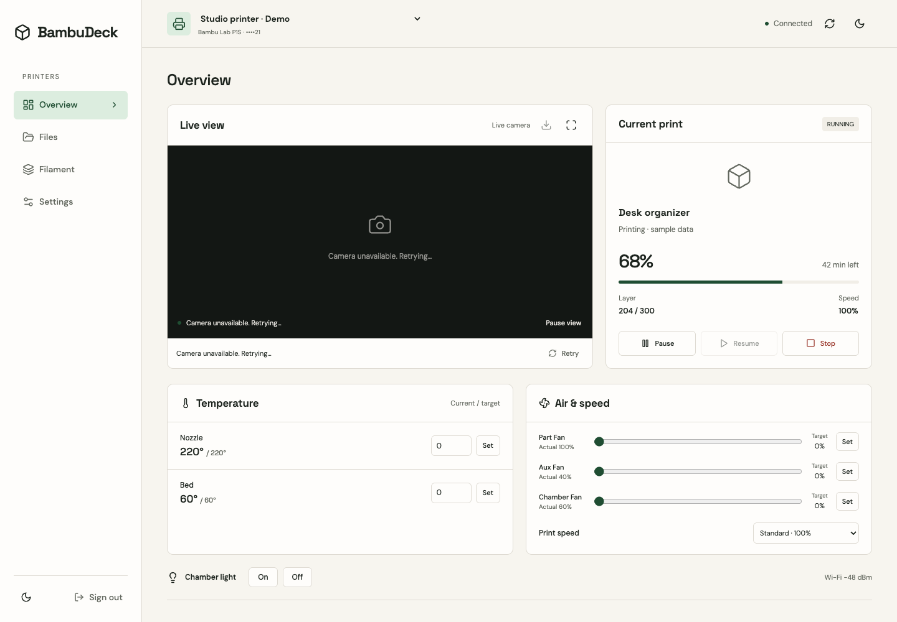
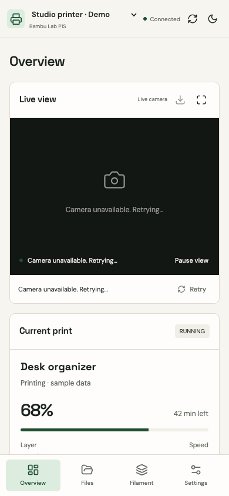

# BambuDeck

A mobile dashboard for Bambu Lab printers in LAN mode. Monitor prints and cameras, manage files and AMS filament, and control printers from a Vue PWA. Bun/Elysia serves the app and stores credentials in encrypted SQLite.

[Documentation](https://ripwords.github.io/BambuDeck/) · [Docker Hub](https://hub.docker.com/r/ripwords/bambudeck)

## Screenshots

Desktop and mobile views with sample printer data. No live camera is connected in these previews.



<details>
<summary>Mobile dashboard</summary>



</details>

## Run with Docker

```sh
mkdir bambudeck
cd bambudeck
curl -fsSL https://raw.githubusercontent.com/Ripwords/BambuDeck/main/compose.production.yaml -o compose.production.yaml
docker compose -f compose.production.yaml up -d
```

Open `http://localhost:3000`, or `http://<docker-host-ip>:3000` from your phone. Create a password and add your printer's IP address, LAN access code, and serial number. Enable LAN mode and let the Docker host reach the printer.

Published images support AMD64 and ARM64. If no release is published yet, build locally:

```sh
git clone https://github.com/Ripwords/BambuDeck.git
cd BambuDeck
docker compose up -d --build
```

The `dashboard-data` volume preserves configuration. Back up the entire `/data` directory, including `secret.key`, or retain your external `APP_ENCRYPTION_KEY` separately. Losing the key makes stored credentials unreadable.

## Guides

- [Docker setup](docs/getting-started.md)
- [Features](docs/FEATURES.md)
- [HTTPS and iPhone installation](docs/HTTPS.md)
- [Configuration and development](docs/configuration.md)
- [Publishing, upgrades, and backups](docs/deployment.md)
- [Verification and hardware limitations](docs/VERIFICATION.md)

Camera delivery uses same-origin JPEG snapshots with FFmpeg included for RTSP printers. Physical printer, Home Assistant, and iPhone camera compatibility still need hardware verification.

## Develop

Use Node.js 22 and Bun 1.4.2.

```sh
bun install --frozen-lockfile
bun run dev:server
```

In another terminal, run `bun run dev`. Check changes with `bun run typecheck`, `bun run build`, and `bun run docs:build`. No automated tests are included.
